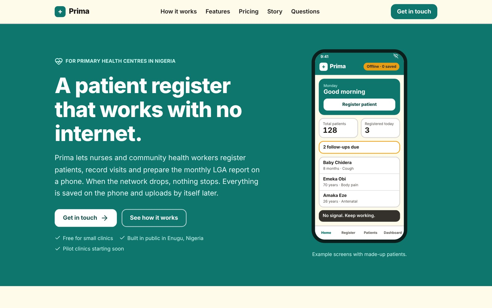

# Delightsome — Chukwunonso Ofili

Personal portfolio of **Chukwunonso Ofili (Nonso)**, a digital health and fullstack software developer from Enugu, Nigeria.

I build offline first tools for clinics, hospital systems, and fullstack web products from the database to the deploy.

**Live:** [delightsome.vercel.app](https://delightsome.vercel.app)



## Featured work

| Project                                                      | What it is                                                                                                                                         | Stack                                                 |
| ------------------------------------------------------------ | -------------------------------------------------------------------------------------------------------------------------------------------------- | ----------------------------------------------------- |
| [Prima](https://github.com/delightofili/Prima)               | Offline first patient register for Primary Health Centres in Nigeria. Sync between phones with no internet, FHIR and DHIS2 export, four languages. | React, TypeScript, Dexie, Supabase, FastAPI, Paystack |
| [MedCore HMS](https://github.com/delightofili/medcore-hms)   | Multi tenant hospital management system, from reception to billing, with nine roles.                                                               | NestJS, Next.js, PostgreSQL, Prisma, Redis            |
| [Nexus Ledger](https://github.com/delightofili/Nexus-Ledger) | Double entry financial ledger with payments and blockchain reconciliation.                                                                         | Node.js, TypeScript, PostgreSQL, Prisma, ethers.js    |
| [DevFlow](https://github.com/delightofili/devflow)           | Project management platform for software teams with real time updates.                                                                             | Next.js, Prisma, Socket.IO, NextAuth                  |

Every project has its own case study page at `/work/[slug]`.

## What is in this site

- Orange curtain splash screen with a counter
- Custom cursor with a trailing ring that reacts to links, project images and text fields (mouse devices only)
- Magnetic buttons, scroll progress bar, sliding navbar pill that follows the active section
- Headline reveal with a self drawing underline, mouse driven photo tilt and floating chips
- Infinite marquees, a scroll linked journey timeline, counting stats
- Filterable work page (All, Health tech, Fullstack, Frontend) with layout animations
- Contact form that sends email through Resend
- Respects the reduced motion setting on the visitor's device

## Tech stack

- [Next.js 16](https://nextjs.org) (App Router)
- React 19 with the React Compiler
- [Tailwind CSS v4](https://tailwindcss.com)
- [Motion](https://motion.dev) for animation
- Lucide and React Icons
- [Resend](https://resend.com) for the contact form
- Deployed on Vercel

## Project structure

```
src/
  app/
    components/      every section and motion helper
    work/            /work page and /work/[slug] case studies
    api/contact/     contact form endpoint
    layout.js        fonts, metadata, global providers
    page.js          home page
    globals.css      design tokens (orange, ink, paper)
  data/
    projects.js      all projects, edit here to add one
    skills.js        skill groups shown in the Skills section
public/
  projects/          preview images
```

## Run it locally

```bash
git clone https://github.com/delightofili/delightsome-portfolio.git
cd delightsome-portfolio
npm install
npm run dev
```

Open http://localhost:3000.

For the contact form, create `.env.local`:

```
RESEND_API_KEY=your_resend_key
CONTACT_EMAIL=you@example.com
```

## Adding a project

Add an object to `src/data/projects.js` with a `type` of `health`, `fullstack` or `frontend`, and put its image in `public/projects/`. The home page, the work page and the case study page all update from that one file.

## Contact

- Email: delightofili0@gmail.com
- LinkedIn: [delightofili](https://www.linkedin.com/in/delightofili)
- X: [@DelightOfili](https://x.com/DelightOfili)
- GitHub: [delightofili](https://github.com/delightofili)
